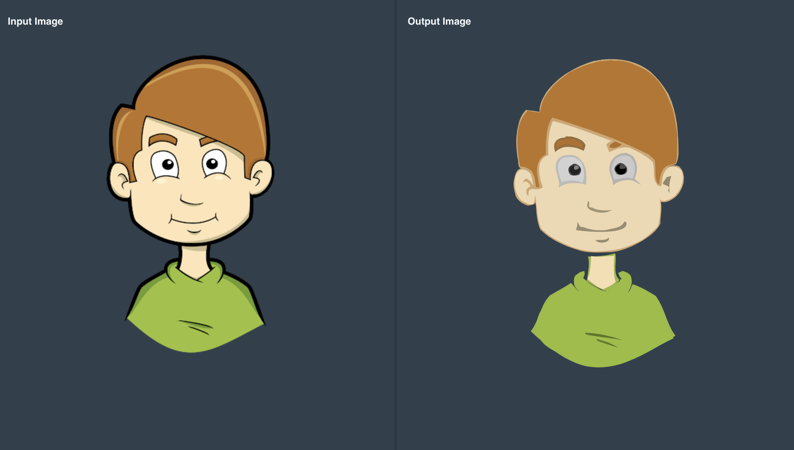
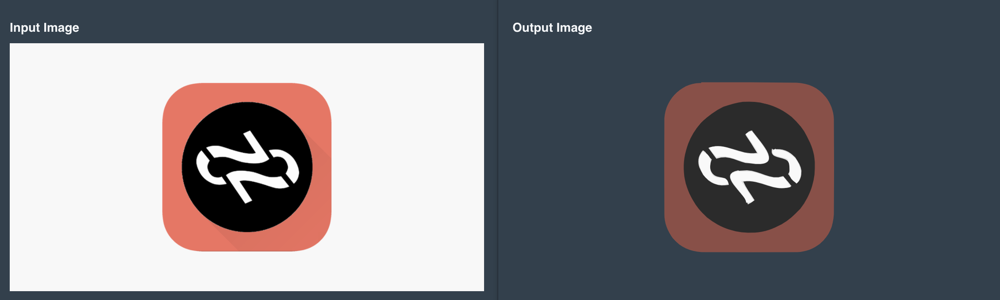
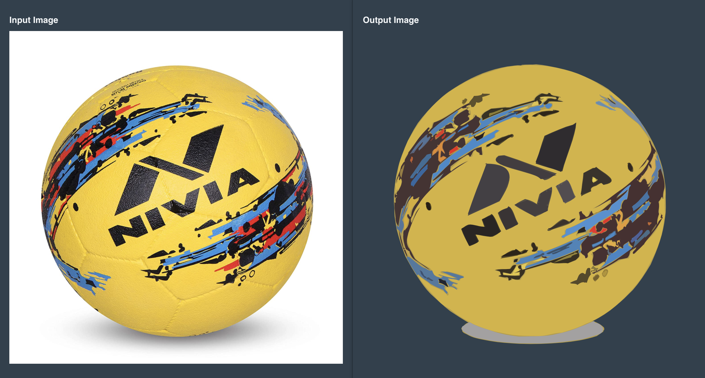

# AutoSvg
<!-- ALL-CONTRIBUTORS-BADGE:START - Do not remove or modify this section -->
[](#contributors-)
<!-- ALL-CONTRIBUTORS-BADGE:END -->

Autosvg is tracing tool, which can convert image format like (jpg,png,gif) into vector svg.
You can check your result here (Live Demo)[https://autosvg.now.sh]. 

### Results

#### Clipart tracing

#### Logo tracing

#### Image tracing


### Building AutoSVG-WASM.js

#### Option 1: Docker (recommended)

Builds a slim WASM artifact in a reproducible Ubuntu 22.04 environment. No
host-side dependencies beyond Docker — the image installs cmake, boost,
emscripten, and a trimmed OpenCV WASM build internally.

```bash
# from the repo root
DOCKER_BUILDKIT=1 docker build -t autosvg .

mkdir -p out
docker run --rm -v "$PWD/out:/src/autosvg/out" autosvg \
  bash -c "bash build-slim.sh && cp autosvg-wasm.* /src/autosvg/out/"
```

After it finishes, `out/autosvg-wasm.js` and `out/autosvg-wasm.wasm` are
on the host. Copy them into the UI app:

```bash
cp out/autosvg-wasm.* src/autosvg_ui/public/
```

##### Native CLI build (also via Docker)

The image also contains a `build-cli.sh` that produces a native
`autosvg` binary (uses system OpenCV + cxxopts, no emscripten).

```bash
mkdir -p out
docker run --rm -v "$PWD/out:/src/autosvg/out" autosvg \
  bash -c "bash build-cli.sh && cp autosvg /src/autosvg/out/"
```

Run the CLI inside the container against an input image:

```bash
docker run --rm \
  -v "$PWD/assets:/in:ro" \
  -v "$PWD/out:/out" \
  autosvg \
  bash -c "bash build-cli.sh && ./autosvg -i /in/test_images/test23.png -o /out/test23.svg"
```

Flags (per `src/cpp/AutosvgCLI.cpp`):

```
-i, --input        Input filename (png/jpg)
-o, --output       Output SVG filename (default: out.svg)
-k, --colors       Number of dominant colors (default: 3)
-s, --smoothness   Curve smoothness index (default: 5)
-h, --help         Print usage
```

##### Optional: time the build and log exit code

```bash
{ time docker run --rm -v "$PWD/out:/src/autosvg/out" autosvg \
    bash -c "bash build-slim.sh && cp autosvg-wasm.* /src/autosvg/out/"; } \
  > >(tee -a build.log) 2> >(tee -a build.log >&2)
echo "exit_code=$? finished_at=$(date -Iseconds)" | tee -a build.log
```

##### What the Dockerfile does differently from `build.sh`

- Re-clones `emsdk` fresh inside the container (the pinned submodule
  references `emscripten-releases:master`, which was renamed to `main`).
- Builds only `opencv_core`, `opencv_imgproc`, and `opencv_imgcodecs` —
  the modules autosvg actually calls — via `build_js.py --config_only` +
  direct `make` targets. Skips `opencv_js` bindings (they require C++17
  embind headers which fight with the pinned OpenCV's C++11 sources).
- Patches `CMakeLists.txt` to C++17 (required by `emscripten/bind.h`) and
  re-enables `std::binary_function` / `std::bind2nd` via
  `_LIBCPP_ENABLE_CXX17_REMOVED_*` macros for `underscore.hpp`.
- Excludes `AutosvgCLI.cpp` from the WASM target — it depends on
  `cxxopts.hpp` (not vendored) and is irrelevant for WASM output.
- Symlinks `/usr/include/boost` to `/usr/local/include/boost` so the
  hardcoded macOS-style include path resolves on Ubuntu.

The on-disk `CMakeLists.txt` is not modified; patches are applied
in-container at build time.

#### Option 2: Native build

##### Prerequisite

- cmake, boost,  python

- MacOS
```bash
> brew install cmake boost
```

##### Automatic Setup 
```bash
> git submodule update --init

> sh build.sh
```

##### Manual Setup 
```bash
#
# https://github.com/emscripten-core/emsdk.git
#
export EMSDK=< path to Emscripten SDK repo>
#
# https://github.com/opencv/opencv.git
#
export OPENCV_SDK=<path to opencv repo>
#
# https://github.com/dpilger26/NumCpp.git
#
export NUMCPP=<path to numcpp repo>
``` 

- Build Emscripten 
> https://emscripten.org/docs/getting_started/downloads.html


- Build OpenCV WASM

```bash
cd $OPENCV_SDK
python ./platforms/js/build_js.py build_wasm --build_wasm
cd ../..
```

- Run cmake building script for emscripten tool chain via 
```bash
> cmake -DCMAKE_TOOLCHAIN_FILE=${EMSDK}/upstream/emscripten/cmake/Modules/Platform/Emscripten.cmake
```   
- Run make command to complile source code and building WASM file.
```bash
> make
Scanning dependencies of target autosvg-wasm
[ 25%] Building CXX object CMakeFiles/autosvg-wasm.dir/src/cpp/AutosvgWASM.cpp.o
[ 50%] Building CXX object CMakeFiles/autosvg-wasm.dir/src/cpp/core/Operations.cpp.o
[ 75%] Building CXX object CMakeFiles/autosvg-wasm.dir/src/cpp/utils/CurveUtils.cpp.o
[100%] Linking CXX executable autosvg-wasm.js
[100%] Built target autosvg-wasm 
```
- Copy wasm files to ui-app public folder. 
```bash
cp autosvg-wasm.* src/autosvg_ui/public
```

### Running AutoSVG-UI
```bash
> cd src/autosvg_ui/ && npm install
> npm run start 
```


## Contributors ✨

Thanks goes to these wonderful people ([emoji key](https://allcontributors.org/docs/en/emoji-key)):

<!-- ALL-CONTRIBUTORS-LIST:START - Do not remove or modify this section -->
<!-- prettier-ignore-start -->
<!-- markdownlint-disable -->
<table>
  <tr>
    <td align="center"><a href="http://www.cwithabhas.com"><br /><sub><b>Abhas Tandon</b></sub></a><br /><a href="https://github.com/anuj-kosambi/autosvg/commits?author=abhas9" title="Code">💻</a></td>
    <td align="center"><a href="https://github.com/prasoonhari"><br /><sub><b>Prasoon</b></sub></a><br /><a href="https://github.com/anuj-kosambi/autosvg/commits?author=prasoonhari" title="Code">💻</a></td>
  </tr>
</table>

<!-- markdownlint-restore -->
<!-- prettier-ignore-end -->

<!-- ALL-CONTRIBUTORS-LIST:END -->

This project follows the [all-contributors](https://github.com/all-contributors/all-contributors) specification. Contributions of any kind welcome!
